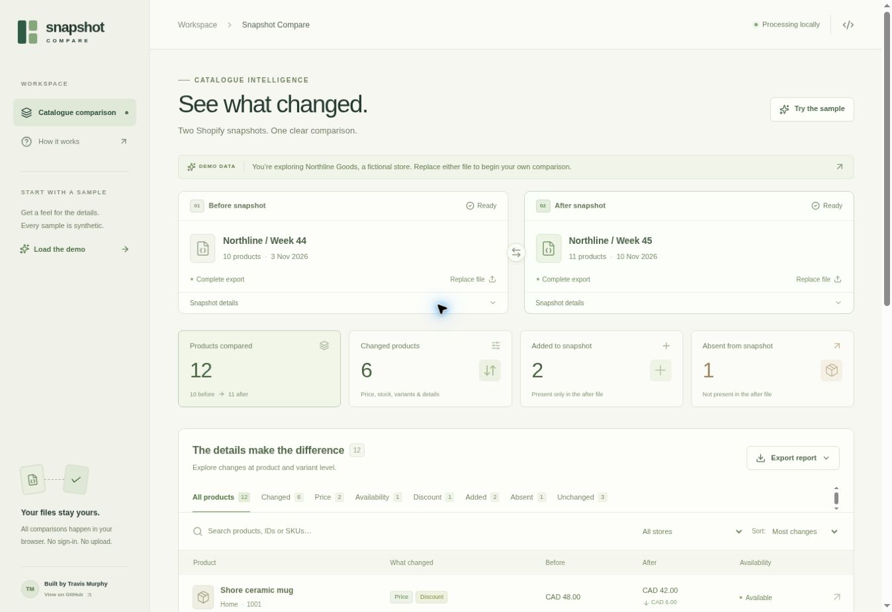
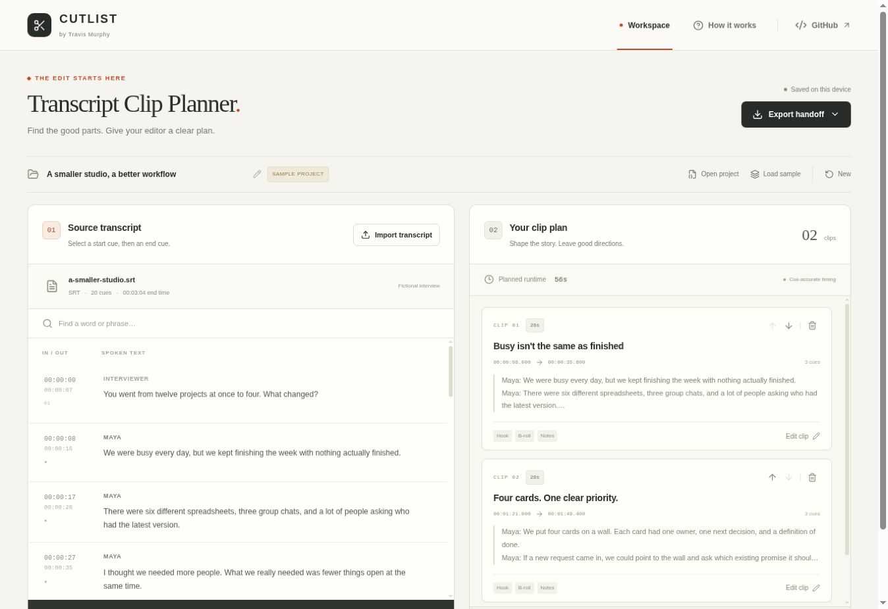
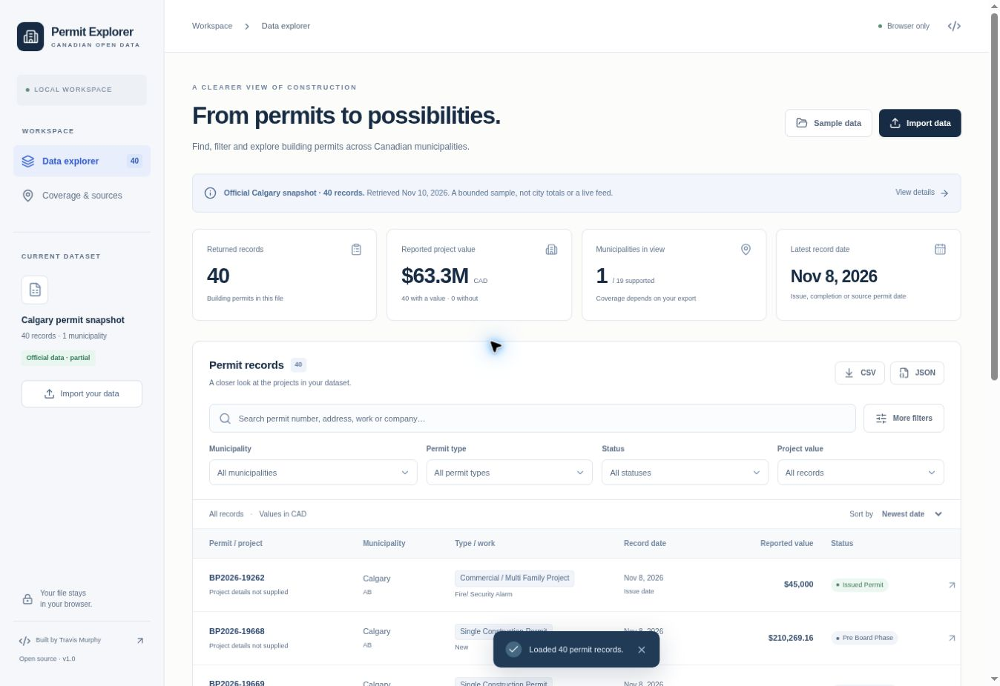

# Practical tools for data and content work

Three browser apps by **[Travis Murphy](https://github.com/travisjmurphy)**: compare a store's catalogue, turn an interview into an editor's brief, and explore Canadian building-permit exports.

Each app includes source code, sample inputs, example outputs, tests, and its own setup instructions. Open a demo to try the workflow immediately, or run a standalone copy locally. File processing happens in your browser; the apps do not require API keys or paid services.

## Try the projects

| Project | What you can do | Try it | Explore the code |
| --- | --- | --- | --- |
| **Shopify Snapshot Compare** | Compare product and variant changes between two exports; download a CSV or HTML report. | [Demo](https://travis-shopify-snapshot-compare.divineburl2.chatgpt.site) | [Source and README](apps/shopify-snapshot-compare) |
| **Transcript Clip Planner** | Select moments from SRT/VTT transcripts, arrange clips, and export a brief with timestamps and editorial notes. | [Demo](https://travis-transcript-clip-planner.divineburl2.chatgpt.site) | [Source and README](apps/transcript-clip-planner) |
| **Canadian Permit Explorer** | Filter permit records, inspect source attribution, and export the relevant results. | [Demo](https://travis-canadian-permit-explorer.divineburl2.chatgpt.site) | [Source and README](apps/canadian-permit-explorer) |

### Shopify Snapshot Compare

**The question:** what changed between these two catalogue exports?

Inspect prices, discounts, availability, product details, and variants. Search and filter the changes, open a product for the full comparison, then download the current result. Matching uses product IDs within each store. Missing values stay unknown, and a product absent from an export is not automatically labelled discontinued.

The opening sample is a fictional store with ten products before and eleven after. It includes six changed products, two added to the snapshot, one absent, and three unchanged.

[Open the demo](https://travis-shopify-snapshot-compare.divineburl2.chatgpt.site) · [Read the implementation](apps/shopify-snapshot-compare) · [Example report](apps/shopify-snapshot-compare/examples/sample-report.csv)



### Transcript Clip Planner

**The question:** how do I turn promising interview moments into a clear editing brief?

Import SRT or WebVTT subtitles, select consecutive cues, and arrange the resulting clips. Add a title, hook, B-roll ideas, and editor notes. Export a Markdown brief or CSV clip list, with a JSON backup for reopening the project. The workspace autosaves in the current browser.

The sample interview and clip plan are fictional. This tool plans the edit; it does not transcribe audio or render video. Cue timings and the original source text travel with the handoff.

[Open the demo](https://travis-transcript-clip-planner.divineburl2.chatgpt.site) · [Read the implementation](apps/transcript-clip-planner) · [Example brief](apps/transcript-clip-planner/public/samples/example-handoff.md)



### Canadian Permit Explorer

**The question:** which records in this permit export are relevant to my research?

Filter JSON or CSV records by municipality, type, status, dates, reported value, and text. Inspect an individual permit's source and licence, then export the filtered rows with their attribution intact. The interface keeps different date meanings and missing values visible.

The app starts with **40 real Calgary records**, retrieved from the city's official open-data API on November 10, 2026. This is a bounded snapshot, not a complete city total or live feed. A separate fictional dataset demonstrates the 19 municipalities in the companion Actor's documented coverage.

[Open the demo](https://travis-canadian-permit-explorer.divineburl2.chatgpt.site) · [Read the implementation](apps/canadian-permit-explorer) · [Data provenance](apps/canadian-permit-explorer/docs/DATA_PROVENANCE.md)



## Run a project locally

Use **Node.js 24**. Each app is an independent Vite, React, and TypeScript package with its own lockfile.

```sh
git clone https://github.com/travisjmurphy/automation-portfolio.git
cd automation-portfolio/apps/shopify-snapshot-compare
npm ci
npm run dev
```

Choose `transcript-clip-planner` or `canadian-permit-explorer` in the `cd` command to run another app. Open the local URL printed by Vite.

```sh
npm test
npm run build
npm run preview
```

The build creates static files in the selected app's `dist/` directory. The public demos use the same application components and core logic with a hosting-specific wrapper.

## What to look for in the code

- **Data handling:** store-scoped product identity, source cue timing, and permit attribution are preserved through each workflow.
- **Useful failure states:** malformed imports, incomplete data, unknown values, and storage failures have explicit handling.
- **Portable outputs:** reports, editing briefs, project backups, and filtered records can be used outside the apps.
- **Focused tests:** pure logic tests cover parsing, comparisons, timing, filters, round trips, and export escaping. See the [verification notes](docs/VERIFICATION.md).

Shopify comparisons and permit imports remain in memory for the current page session. The transcript planner stores its project in the browser's local storage; export a backup when you need to keep it across devices or browser resets. Individual READMEs explain the import limits and storage behaviour.

## Related automation work

| Project | Status and evidence |
| --- | --- |
| [Shopify Store Products](case-studies/shopify-store-products.md) | Published Apify Actor for reading public storefront product feeds. The comparison app can work with its exports. |
| [Canada Building Permits](case-studies/canada-building-permits.md) | Published Apify Actor with documented coverage of 19 municipalities. The explorer works with its normalized permit schema. |
| [Make lead-intake pilot](case-studies/make-lead-intake.md) | Inactive demonstration tested with fictional inquiries: duplicate prevention, a privacy filter, and a reply preview marked `NOT_SENT`. |

The Actor source code is separate from this repository. The Make case study includes a workflow diagram and [illustrative inputs](examples/make-lead-intake); the exact tested blueprint is not yet included as an importable template.

## About my work

My background is copywriting, research, and video production. I build tools around the practical details of those workflows, using Codex, Grokbot, and other AI tools to help implement, test, and document the work. This repository makes the resulting code, behaviour, and limitations available to inspect.

[Apify store](https://apify.com/loudtzu) · [Contribution guide](CONTRIBUTING.md) · [Changelog](CHANGELOG.md)

## Licence

Application code is released under the [MIT License](LICENSE). Municipal data retains its own licence and attribution. See [third-party notices](THIRD_PARTY_NOTICES.md) and the permit app's [data provenance](apps/canadian-permit-explorer/docs/DATA_PROVENANCE.md).
