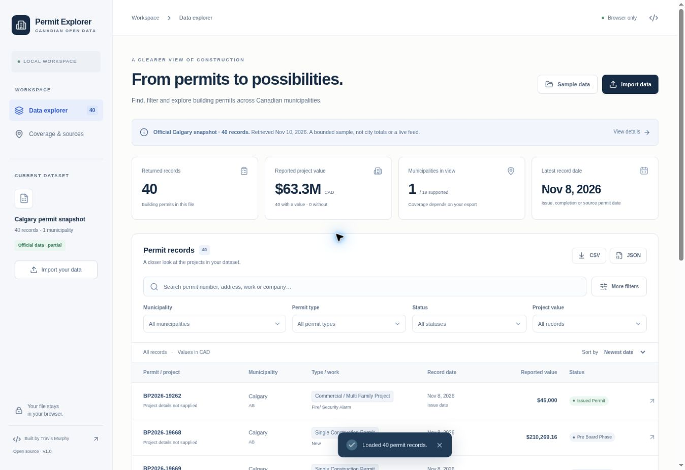

# Canadian Permit Explorer

A browser workspace for exploring building-permit exports: find relevant projects, inspect their sources, and download the filtered records.

**[Open the live demo](https://travis-canadian-permit-explorer.divineburl2.chatgpt.site)** · **[Source](https://github.com/travisjmurphy/automation-portfolio/tree/main/apps/canadian-permit-explorer)** · **[Data provenance](docs/DATA_PROVENANCE.md)**



## Try it

The app opens with 40 real permit records from the City of Calgary's official open-data API. The snapshot was retrieved November 10, 2026 and is deliberately bounded. It is not a live feed, a complete municipal total, or an executed Apify Actor export.

1. Search for `alarm`, choose a permit type, or open **More filters** to set dates and values.
2. Open any permit to see its original fields, source link and licence.
3. Export the current result as CSV or JSON.
4. Choose **Sample data → Explore all 19 municipalities** to try a clearly fictional multi-city dataset, including missing values and Delta's completion-date semantics.
5. Choose **Import data** to load your own `.json` or `.csv` file, or paste an export.

All processing happens in the browser. No account, API key, upload, background scraping, geocoding or paid Actor execution is required to use this app. Imported data is held in memory for the current page session. Reloading the page restores the bundled official sample.

## What it does

- Reads JSON arrays, JSON envelopes with `records`, `items` or `data`, and CSV exports.
- Filters by municipality, province/source label, permit type, status, date, reported value and text.
- Sorts and paginates up to 50,000 records / 20 MB per file.
- Shows totals only for returned records, with the count of values that are missing.
- Keeps permit revisions as separate rows rather than deduplicating by permit number.
- Preserves row source/licence attribution and original fields in exports.
- Explains partial coverage and surfaces invalid dates, missing attribution and excluded mixed-source rows.
- Offers responsive layouts, keyboard-operable controls, native accessible dialogs and reduced-motion support.

## Data compatibility

Designed around the published permit-only schema of [loudtzu/canada-building-permits](https://apify.com/loudtzu/canada-building-permits), checked November 10, 2026. The Actor's 19 supported municipalities are Halifax, Calgary, Edmonton, Red Deer, Lethbridge, Strathcona County, Winnipeg, Toronto, Mississauga, Oakville, Burlington, Kitchener, Waterloo, Kingston, Vancouver, Victoria, Surrey, Delta and Maple Ridge.

Important fields:

| Export field | Explorer use |
| --- | --- |
| `city`, `provinceCode` / `province` | Municipality and source province labels |
| `permitNumber`, `revisionNumber` | Original permit identifiers; revisions preserved |
| `permitType`, `workType`, `status` | Original local categories; no universal category inference |
| `issuedDate` | Issue date in most municipalities |
| `completedDate` | Completion date for Delta; mapped `issuedDate` is accepted as a fallback |
| `permitDate` | Red Deer's source permit date; retained as a distinct date basis |
| `estimatedValueCad` | Positive reported CAD estimates; missing or zero values remain unreported |
| `project_address`, `work_description`, `contractor_company` | Displayed only when supplied |
| `source`, `licence`, `permitUrl`, `source_url` | Attribution and safe HTTP(S) source links |

An optional JSON `metadata` object can carry `name`, `retrievedAt`, `completeness`, `description`, `sourceQuery`, `licence` and `synthetic`. Original metadata is preserved in JSON exports. The UI allows a missing source retrieval date to be supplied; it does not confuse import time with retrieval time.

Rows marked `signal_type: "permit"` are accepted. Licences, planning applications, federal tenders and contract awards from optional mixed-source exports are excluded with diagnostics. This version does not join records, infer identities, rank sales leads or analyze city growth.

### Interpretation rules

- **Returned records are not city totals.** An export can be filtered, capped, incomplete or affected by source failures. Check the original Actor run and `ERRORS` / `SOURCE_DIAGNOSTICS` separately; this app cannot reconstruct absent diagnostics.
- **Missing is not zero.** Delta and Winnipeg do not report project values in this feed. Zero estimated project values follow the Actor's unreported-value convention. Real zero unit counts remain unchanged in raw fields and exports.
- **Dates have different meanings.** Delta is labelled “Completion date”; Red Deer is labelled “Permit date.” Invalid dates stay as undated rows with a warning. Date ranges exclude undated records.
- **Amounts are estimates.** The displayed sum only includes positive reported values in the current result; it is not spending, economic output or a complete construction-market measure.
- **No global deduplication.** Toronto revisions and repeated permit identifiers remain visible. Counts are source rows, not guaranteed unique physical projects.
- **Exports preserve attribution.** CSV also includes `explorer_effective_date`, `explorer_date_basis` and `explorer_retrieved_at`. Text cells that could execute as spreadsheet formulas are prefixed with an apostrophe. JSON preserves original values without that spreadsheet-specific transformation.

## Development

Node 22.13+ is required for the native TypeScript test runner. The application is React + TypeScript; its parser, filters and exporters are pure functions with no network access.

```bash
npm ci
npm run dev

# Run the data-integrity checks and build a static app
npm test
npm run build
npm run preview
```

This package uses Vite, React and TypeScript. Tailwind supplies the same CSS base reset used by the hosted app; the interface is styled in `app/globals.css`. No server, database, paid service or environment variables are required. The `dist/` build can be served by a static host. The hosted demo uses the same application and data logic in its hosting runtime.

Main application files:

- `app/page.tsx` — explorer, filters, dialogs and downloads.
- `app/globals.css` — responsive design and accessibility states.
- `lib/permits.ts` — parser, normalization, filters, sorting, summary and exports.
- `lib/sample.ts` — clearly fictional multi-city sample.
- `public/samples/` — official snapshot and importable fictional fixtures.
- `tests/permits.test.mjs` — meaningful data-integrity checks.

The tests cover quoted/multiline CSV, malformed files, null/zero semantics, date validity, Delta/Red Deer date basis, inclusive ranges, mixed-source exclusion, revision preservation, formula-safe exports, metadata retention, safe source URLs, and the attribution of the real bundled sample.

## Scope of this release

No automatic refresh, live Actor integration, user accounts, persisted datasets, map geocoding, countrywide coverage or comparative growth claims. Browser responsiveness depends on file size and device; the import cap is enforced before records are displayed. The interface only understands the documented normalized fields, rather than every city's raw API schema.

## Credits and licence

Created by Travis Murphy, with AI-assisted implementation. Application code is MIT licensed. The Calgary snapshot contains information licensed under the **Open Government Licence – City of Calgary**, and its attribution is preserved per row. Fictional fixtures are CC0-1.0. Municipal data licences are independent of the application licence. See [data provenance](docs/DATA_PROVENANCE.md).
