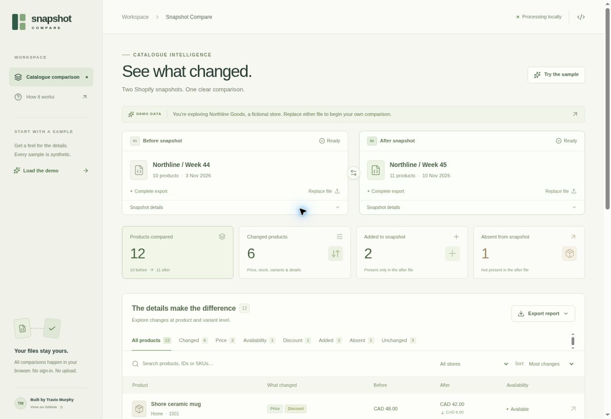

# Shopify Snapshot Compare

**Drop in two catalogue exports. See exactly what changed.**

A browser-based comparison tool for Shopify product snapshots. Inspect product and variant changes, filter the results, and download a CSV or standalone HTML report. Files are processed in your browser; no account, API key, or upload is required.

[Open the live demo](https://travis-shopify-snapshot-compare.divineburl2.chatgpt.site) · [Source](https://github.com/travisjmurphy/automation-portfolio/tree/main/apps/shopify-snapshot-compare) · [Before sample](public/examples/before.json) · [After sample](public/examples/after.json)



## Try it

The app starts with clearly labelled synthetic data for **Northline Goods**, a fictional store. The sample has ten products before and eleven after: six changed products, two products added to the snapshot, one absent, and three unchanged. Select a product to inspect the exact changes.

1. Export the same store or collection at two points in time. JSON exports from [Shopify Store Products on Apify](https://apify.com/loudtzu/shopify-store-products) are supported; compatible exports work too.
2. Replace the **Before** and **After** files, using the file buttons or drag and drop.
3. Open **Snapshot details** to set the export capture date and coverage. A raw Actor export defaults to unknown coverage and date.
4. Search or filter, then select a product for the complete product and variant comparison.
5. Export the filtered results to CSV or HTML. All filtered rows are included, including rows on other pages.

## What it does

- Matches stable product IDs **within each store**, never across different stores.
- Compares price ranges, sale status, reported discounts, availability, names, vendor and product type.
- Matches variants by variant ID and compares price, compare-at price, availability, title and SKU.
- Identifies products and variants present in only one snapshot.
- Filters by change type, store and search query; sorts by number of changes, product name or store.
- Downloads standalone CSV and HTML reports with snapshot dates, coverage and interpretation notes.
- Saves normalized snapshots, including any metadata you have supplied.
- Accepts up to 50,000 products and 10 MB per file; paginates results in the interface.

## Run locally

Requires Node.js 22.13 or later (Node.js 24 recommended).

```bash
npm ci
npm run dev
```

Use the development URL printed in the terminal. This standalone package uses Vite, React and TypeScript. `npm run build` writes static assets to `dist/`; `npm run preview` previews that build locally. The hosted demo uses the same application and comparison logic with a different hosting wrapper. It does not require a database, credentials, or environment variables to compare files.

```bash
npm test
npm run build
```

The comparison logic is independent of the UI and lives in [`lib/compare.ts`](lib/compare.ts).

## Input format

A raw JSON array of product objects is accepted directly. To preserve snapshot metadata, use an object with `meta` and `products`:

```json
{
  "meta": {
    "label": "November catalogue",
    "capturedAt": "2026-11-10",
    "completeness": "complete"
  },
  "products": [
    {
      "store": "my-store.example",
      "productId": "123",
      "title": "Ceramic mug",
      "currency": "CAD",
      "priceMin": 24,
      "priceMax": 24,
      "available": true,
      "onSale": false,
      "maxDiscountPct": 0,
      "variants": [
        {
          "variantId": "123-blue",
          "title": "Blue",
          "sku": "MUG-BLUE",
          "price": 24,
          "compareAtPrice": null,
          "available": true
        }
      ]
    }
  ]
}
```

`productId` and a store domain (or a valid product URL from which the domain can be read) are required. String IDs preserve long numeric identifiers. A numeric ID must be a safe integer. Duplicate product/store or variant IDs are rejected rather than guessed away.

Prices may be numbers or plain non-negative decimal strings. Availability must be `true`, `false` or `null`. Omitted values stay unknown. Optional metadata fields include `capturedAt` (ISO date), `completeness` (`complete`, `partial`, or `unknown`), `label`, and `synthetic`.

A product's `updatedAt` is not used as its snapshot capture date. A feed item update and the time of an export are different events.

## How to interpret the results

**“Added” means present only in the after snapshot. “Absent” means present only in the before snapshot.** Neither proves that a product was launched or discontinued. Collections, filters, request errors and result caps can change which records appear in an export. Select complete coverage only when you know both exports cover the intended scope.

- Price comparisons require a known, identical currency in both snapshots. No currency conversion is performed.
- Missing prices are not zero. A genuinely zero price is supported.
- Unknown availability is not “unavailable” and is recorded as a data change rather than a confirmed availability change.
- Availability indicates whether a product or variant can be bought, not its inventory quantity.
- If either snapshot omits the variants array, variant comparison is skipped and noted.
- Product summary counts do not double-count variant events. A matched product with a new variant is a changed product, not a new product.
- “Unchanged” means the compared fields match. Images, descriptions, reviews, and the full storefront are outside this version's comparison.

## Examples and validation

- [`public/examples/before.json`](public/examples/before.json) and [`public/examples/after.json`](public/examples/after.json): the synthetic sample used in the app.
- [`examples/sample-report.csv`](examples/sample-report.csv) and [`examples/sample-report.html`](examples/sample-report.html): generated output for the entire synthetic comparison.
- [`tests/compare.test.mjs`](tests/compare.test.mjs): 13 meaningful tests covering store isolation, variant changes, unknown stock and currency, missing prices, zero prices, partial coverage, reversed dates, malformed records, report escaping and snapshot round trips.

Reports escape imported HTML. CSV cells that could be treated as spreadsheet formulas are prefixed with a quote. Product links are not automatically fetched and imported images are not loaded.

## Current scope

Version 1.0 is a working comparison tool for user-supplied exports. It does not scrape stores, refresh data automatically, send notifications, or call Apify. Fresh exports may be created separately with the linked Actor. Files and edits are kept only in the current page session and are cleared on reload; use **Save before file** and **Save after file** to keep metadata edits.

## Built by

[Travis Murphy](https://github.com/travisjmurphy). Designed around a practical workflow for catalogue research and built with AI assistance. The public tool is separate from the source code of the paid Apify Actor.

## Licence

Original application code is available under the [MIT licence](LICENSE). Third-party dependencies retain their respective licences.
