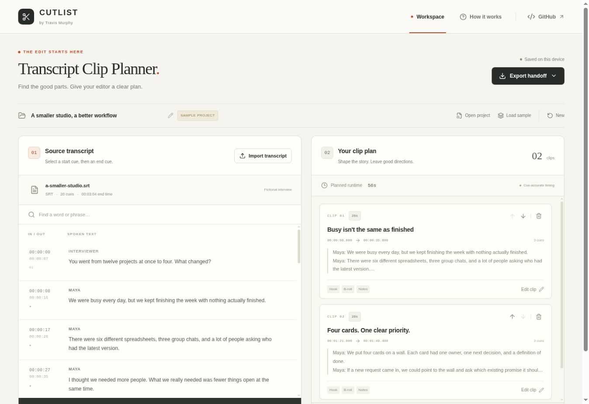

# Cutlist · Transcript Clip Planner

A local browser workspace for turning subtitle transcripts into a clear handoff for a video editor.

**[Open the live app](https://travis-transcript-clip-planner.divineburl2.chatgpt.site)** · **[Source code](https://github.com/travisjmurphy/automation-portfolio/tree/main/apps/transcript-clip-planner)**



## The problem it solves

A producer often knows which moments matter before an editor opens a timeline. Those choices tend to arrive in messages, vague timestamps, and disconnected notes. Cutlist keeps the selected dialogue, exact source cue times, clip order, and editorial direction together.

Import a transcript, select consecutive cues, arrange the clips, and download a useful briefing document. The opening workspace includes a fictional interview and two completed example clips so you can try the entire workflow immediately.

## What works in v1

- **SRT and WebVTT import:** upload, drag and drop, or paste timestamped text. Supports cue identifiers, multiline text, common WebVTT settings and voice tags, and Windows/Mac line endings.
- **Consecutive selections:** choose a start cue and an end cue. Every source cue in between stays in the selection. Backwards selection works as well.
- **Honest timing:** duration spans the first cue start through the latest cue end, including pauses. Overlaps are reported. Milliseconds are retained in exports.
- **Editorial planning:** title, hook/angle, B-roll ideas, and editor notes for each clip; move clips earlier/later; remove with undo.
- **Context-preserving search:** highlight matching words and jump between matches without hiding the rest of the transcript.
- **Markdown and CSV handoffs:** each clip includes source filename, in/out points, duration, dialogue, and notes.
- **Portable project backup:** JSON import/export keeps the whole source, original subtitle text, selected cue IDs, clip order, and notes.
- **Local autosave:** reload the page to resume the workspace in the same browser. A malformed saved workspace is kept available as a recovery download instead of silently overwritten.
- **Keyboard and mobile support:** responsive stacked workspace, native dialog focus management, keyboard selection, and explicit labels.

## Try it

1. Open the live app. The sample has 20 cues and two example clips.
2. Click a source cue, then a later cue, and choose **Add clip**.
3. Name the clip and add a hook, B-roll, or editor notes.
4. Use the arrows on a clip to change its place in the plan.
5. Choose **Export handoff → Markdown brief** or **CSV clip list**.
6. Choose **Project backup** to save a JSON file you can reopen through **Open project**.

To work with your own material, choose **Import transcript**. A successful import replaces the current transcript and clips. Download a backup first if you want to retain the current project.

### Keyboard shortcuts

- **Tab** moves through controls and subtitle cues.
- **Enter / Space** selects a focused cue.
- **Escape**, while a cue is focused, clears the selection.
- **Ctrl + Enter / Command + Enter**, while a cue is focused, adds the selected range.
- Native dialogs support Escape to close and keep focus inside the dialog.

## Example files

The sample is original fictional demonstration material, not a client interview.

- [Sample SRT](public/samples/a-smaller-studio.srt)
- [Equivalent WebVTT](public/samples/a-smaller-studio.vtt)
- [Example project backup](public/samples/example.clipplan.json)
- [Example Markdown handoff](public/samples/example-handoff.md)
- [Example CSV handoff](public/samples/example-handoff.csv)

The two sample selections span `00:00:08.000–00:00:35.800` and `00:01:21.000–00:01:49.400`: **56.200 seconds total**. UI summary durations are rounded to seconds; exports retain milliseconds.

## Run locally

Use Node.js 22.13 or newer.

```sh
npm ci
npm run dev
```

Open the local address printed by the development server. No API key, account, database, or backend service is required for the planner.

```sh
npm test
npm run build
npm run preview
```

This package uses React, TypeScript, and Vite. `npm run build` checks TypeScript and creates a static production build in `dist/`; `npm run preview` serves that build locally. Deploy the contents of `dist/` at the root of any static host. The live demo uses the same application and pure logic in a Vinext hosting shell.

## Structure

| File | Purpose |
| --- | --- |
| `app/page.tsx` | Browser workspace and interaction state |
| `app/globals.css` | Responsive visual design |
| `lib/transcript.ts` | Pure parser, selection resolution, import validation, and exports |
| `lib/sample.ts` | Fictional sample transcript and initial clip plan |
| `tests/transcript.test.mjs` | Input, timing, round-trip, and output correctness tests |
| `public/samples/` | Downloadable examples for trying the workflow |

`src/main.tsx` mounts `app/page.tsx`. The page and pure logic use no framework-specific runtime imports; the portable stylesheet replaces the hosting shell’s Tailwind preflight with a small equivalent reset.

## Timing and scope

This is a **clip planning and editorial handoff tool**. It does not transcribe audio, upload media, render video, generate AI recommendations, or export an NLE timeline. It does not invent word-level timing from cue-level subtitles.

A clip contains whole consecutive cues from one source. Its duration includes any gap between those cues. If two clips overlap in the source, their durations are counted separately in the plan. Imported subtitle text remains unchanged apart from removing presentation tags for the reading/export view; the original text is retained in the project backup.

Review the in/out points against the original recording before making a final cut. WebVTT styling and positioning are not rendered. Nonchronological cues and malformed input produce errors instead of silently losing or rearranging material. Limits are 5 MB per subtitle file, 40 MB per project backup, 5,000 source cues, and 200 clips per project. A backup has a larger limit because it includes both original and display text plus editorial notes. Large workspaces may exceed the browser storage quota; export JSON when autosave reports a failure.

## Privacy and portability

Transcript processing, clip planning, and export happen in the browser. There is no transcript upload endpoint, analytics SDK, external AI call, or remote font dependency in the application. Ordinary requests still load the app itself from the hosting provider, and following the GitHub link navigates to GitHub.

The current project is saved in browser local storage under `transcript-clip-planner:project:v1`. Anyone with access to the same browser profile can access that saved workspace. Clearing browser data removes it. Export a JSON backup for work that needs to survive a browser reset or device change. Storage failures are surfaced in the save status.

CSV fields are quoted and formula-like values are prefixed with an apostrophe to avoid being executed by spreadsheet programs. Imported project data is validated and reconstructed into the supported schema. React renders dialogue and notes as text, not HTML.

## Testing

The included tests cover millisecond timing, BOM/CRLF imports, multiline dialogue, WebVTT metadata/settings/voice tags, malformed cues, out-of-order input, overlapping subtitles, gap-inclusive clip duration, reversed selections, project round trips, invalid references, duplicate IDs, CSV escaping/formula protection, Markdown escaping, and bundled sample consistency.

## Credits and license

Created by **Travis Murphy** with AI-assisted implementation. The project and original fictional sample are released under the [MIT License](LICENSE). React and Lucide icons retain their respective upstream licenses.
