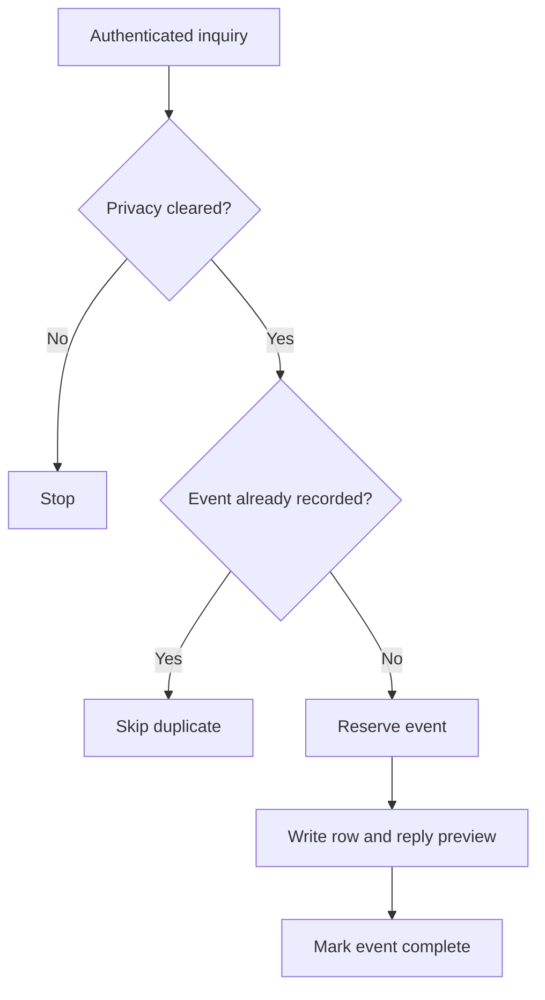

# Make Lead-Intake Pilot

**Status:** tested demonstration; inactive.  
**Data:** fictional inquiries only.  
**Implementation:** built and tested with AI assistance.

## Goal

Demonstrate a small inquiry-intake workflow that records a lead once, checks whether it is cleared for processing, and prepares a reply for review without sending it.

The intended benefit is reducing repeated manual entry while keeping outbound communication under human control. No time-saving or business-outcome measurement has been made.

## Workflow

1. Receive a fictional inquiry through an authenticated webhook.
2. Apply the privacy filter. An inquiry with `privacy_cleared=false` must stop.
3. Check the Make Data Store for an existing event.
4. Reserve a new event before recording it.
5. Add a Google Sheets row, including a reply preview labelled `NOT_SENT`.
6. Mark the event done in the Data Store.

Tools used: **Make, Webhooks, Make Data Store, and Google Sheets**.

### Reuse the documented design

[Fictional inquiry examples and a verification checklist](../examples/make-lead-intake) are included for adapting the design. These new examples are illustrative; they are not a claim to reproduce the exact payloads used in the original pilot. The exact tested blueprint still needs to be exported from Make and sanitized before it can be distributed as an importable template.

## Test results

- **Two distinct fictional inquiries:** each appeared exactly once.
- **Duplicate replay:** duplicate prevention passed.
- **Privacy filter:** `privacy_cleared=false` stopped at the filter.
- **Webhook:** authenticated request validation was checked.
- **Outbound communication:** no emails were sent.
- **Run state:** the scenario was left inactive.

These results describe the tested pilot. They are not evidence of production readiness or a guarantee of exactly-once processing under concurrent requests, outages, or retries.

## Implementation lesson

An imported existence-check token needed correction to Make's native `datastore:ExistRecord` module. Testing the actual scenario, rather than relying on an imported blueprint alone, caught the issue.

## Scope and limits

- No real customer inquiries, advertising traffic, or client outcomes were involved.
- The reply is a preview, not a sent message.
- The scenario is inactive and is not processing live leads.
- This repository does not include an operational webhook URL, authentication values, account identifiers, or a blueprint export.
- The original imported package is not a verified release of the tested scenario.

## Before any live rollout

Further work would include reviewing the exact data fields and permissions, testing concurrent duplicates and failure recovery, adding monitoring, and agreeing on who reviews and sends replies. Any live deployment would be a separate step.

## My role and AI assistance

This is part of my AI-assisted automation portfolio and learning work. AI assistance was used in implementation, testing, and documentation. I use the case study to make the workflow, its test evidence, and its limits clear.
